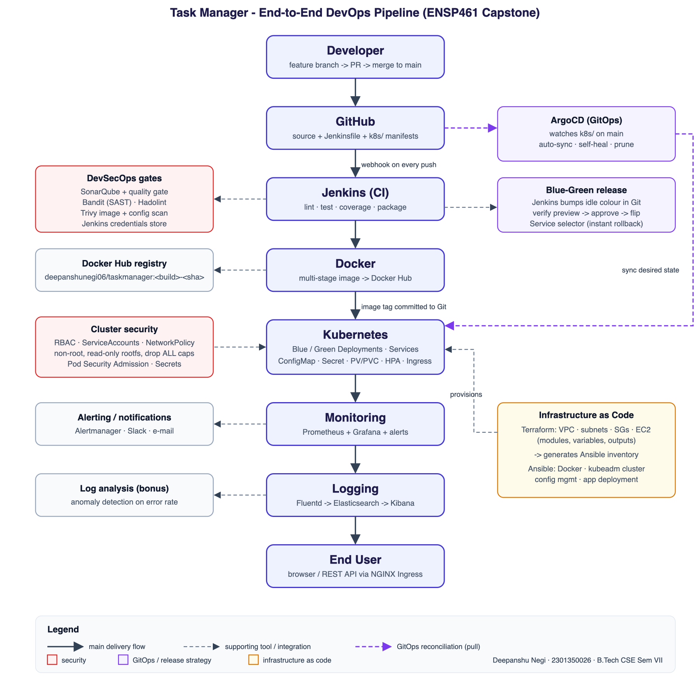

# Task Manager - End-to-End DevOps Pipeline for a Cloud-Native Application

**ENSP461 DevOps & Automation Lab - Capstone Project**
Deepanshu Negi · Roll No. 2301350026 · B.Tech CSE, Semester VII

A Python Flask **Task Manager** (login, task CRUD, REST API, PostgreSQL, responsive UI) delivered
through a complete, automated DevOps pipeline:

`Developer → GitHub → Jenkins → Docker → Kubernetes → Monitoring → Logging → End User`



## How every syllabus phase is covered

| Phase | Requirement | Where it lives |
|---|---|---|
| 1 | Git: repo, branches, merges, **merge conflict resolution**, history | this repo · [docs/GIT_WORKFLOW.md](docs/GIT_WORKFLOW.md) |
| 2 | Jenkins CI: auto build, test, package **on every push** | [Jenkinsfile](Jenkinsfile) · [jenkins/](jenkins/) (Jenkins + SonarQube as code) |
| 3 | Dockerfile, image, Docker Compose | [Dockerfile](Dockerfile) · [docker-compose.yml](docker-compose.yml) |
| 4 | K8s Deployment, Service, ConfigMap, Secret, PV; scaling, rolling update, rollback | [k8s/](k8s/) · [scripts/k8s-demo.sh](scripts/k8s-demo.sh) |
| 5 | Ansible: Docker install, K8s install, app deployment, config management | [ansible/](ansible/) |
| 6 | Terraform with variables, outputs, modules (reproducible) | [terraform/](terraform/) |
| 7 | Prometheus + Grafana: CPU, memory, container health, app metrics | [monitoring/](monitoring/) |
| 8 | Centralized logging (EFK: Fluentd + Elasticsearch + Kibana): app, container, K8s logs | [logging/](logging/) |
| 9 | SonarQube, secret management, secure images, RBAC, Jenkins credentials | [docs/SECURITY.md](docs/SECURITY.md) |
| 10 | **Blue-Green deployment** | [k8s/app/](k8s/app/) · [scripts/blue-green.sh](scripts/blue-green.sh) · Jenkinsfile stages |
| 11 | GitOps with **ArgoCD** | [argocd/](argocd/) |

**Bonus features implemented:** Helm chart ([helm/taskmanager](helm/taskmanager)) · Kubernetes Ingress ·
Auto scaling (HPA) · CI/CD security scanning (Bandit, Hadolint, Trivy, SonarQube) · unit-test coverage
reports (97%) · Slack/e-mail notifications · automated DB backup (CronJob) · AWS cloud deployment (Terraform) ·
log analysis with anomaly detection ([scripts/log_analyzer.py](scripts/log_analyzer.py)).

## The application

| Feature | Implementation |
|---|---|
| User login | session login for the web UI, signed bearer tokens for the API, PBKDF2 password hashes |
| CRUD | tasks with title, description, status, priority, due date (owner-scoped) |
| Database | SQLAlchemy → PostgreSQL 16 (SQLite for tests / local dev) |
| Responsive UI | server-rendered Jinja templates, mobile layout below 640 px |
| REST API | `/api/auth/*`, `/api/tasks`, `/api/tasks/<id>`, `/api/stats` |
| Error handling | JSON errors for `/api/*`, HTML error pages for the UI, validation messages |
| Ops endpoints | `/health/live`, `/health/ready` (DB check), `/version`, `/metrics` (Prometheus) |
| Security | CSRF tokens, security headers (CSP, X-Frame-Options...), open-redirect protection |

### REST API

```bash
# register / login -> token
curl -X POST localhost:8080/api/auth/register -H 'Content-Type: application/json' \
     -d '{"username":"alice","password":"password123"}'
TOKEN=...   # from the response

curl -X POST localhost:8080/api/tasks -H "Authorization: Bearer $TOKEN" \
     -H 'Content-Type: application/json' -d '{"title":"Write report","priority":"high","due_date":"2026-12-01"}'
curl localhost:8080/api/tasks?status=todo -H "Authorization: Bearer $TOKEN"
curl -X PATCH localhost:8080/api/tasks/1 -H "Authorization: Bearer $TOKEN" \
     -H 'Content-Type: application/json' -d '{"status":"done"}'
curl -X DELETE localhost:8080/api/tasks/1 -H "Authorization: Bearer $TOKEN"
```

## Quick start

**Local (no Docker):**
```bash
python3 -m venv .venv && . .venv/bin/activate
pip install -r requirements-dev.txt
pytest --cov                      # 33 tests, 97% coverage
flask --app wsgi run              # http://127.0.0.1:5000
```

**Docker Compose (app + PostgreSQL + Nginx):**
```bash
cp env.example .env               # edit the passwords
docker compose up -d --build      # http://localhost:8080
# + monitoring (Prometheus :9090, Grafana :3000)
docker compose -f docker-compose.yml -f monitoring/docker-compose.monitoring.yml up -d
# + logging (Kibana :5601)
docker compose -f docker-compose.yml -f logging/docker-compose.logging.yml up -d --build
```

**Kubernetes (minikube) with GitOps:**
```bash
minikube start --cpus 4 --memory 8g && minikube addons enable ingress metrics-server
scripts/create-k8s-secret.sh                       # random secrets, never in Git
kubectl create namespace argocd
kubectl apply -n argocd -f https://raw.githubusercontent.com/argoproj/argo-cd/v2.13.1/manifests/install.yaml
kubectl apply -f argocd/project.yaml -f argocd/application.yaml
kubectl -n taskmanager get pods -w
```

The complete step-by-step runbook for the demo (Jenkins, SonarQube, Terraform, Ansible, monitoring,
logging, blue-green switch) and the list of screenshots to capture is in
**[docs/SETUP_GUIDE.md](docs/SETUP_GUIDE.md)**.

## CI/CD pipeline (Jenkinsfile)

```
Checkout → Setup → [flake8 | Bandit | Hadolint] → pytest + coverage → SonarQube → Quality Gate
→ [wheel | Docker image] → Trivy scan → container smoke test → push image (main)
→ GitOps: bump image of the IDLE colour in k8s/ → ArgoCD syncs → verify preview service
→ manual approval → flip live Service selector (blue ↔ green) → Slack / e-mail notification
```

Triggered by a GitHub webhook on every push (`githubPush()`), with SCM polling as a fallback.

## Blue-Green deployment

* `taskmanager-blue` and `taskmanager-green` Deployments run side by side.
* `taskmanager` (live) Service selects one colour; `taskmanager-preview` selects the other.
* A release goes to the idle colour, is tested on `preview.taskmanager.local`, then traffic is switched
  by changing one line in Git (`spec.selector.color`). **Rollback is instant**: switch back - the old
  pods are still running.

```bash
scripts/blue-green.sh status
scripts/blue-green.sh deploy 1.1.0 --push     # new version on idle colour
scripts/blue-green.sh switch --push           # go live
scripts/blue-green.sh rollback --push         # instant rollback
```

## Repository layout

```
taskmanager/          Flask app (models, auth, REST API, web UI, metrics, JSON logging)
tests/                pytest suite (API, web, auth, ops, log analyzer)
Dockerfile            multi-stage, non-root, healthcheck
docker-compose.yml    app + PostgreSQL + Nginx (overlays in monitoring/ and logging/)
Jenkinsfile           CI/CD pipeline
jenkins/              Jenkins + SonarQube as code (JCasC, plugins, RBAC, credentials)
sonar-project.properties
k8s/                  Kubernetes manifests (ArgoCD source of truth)
helm/taskmanager/     Helm chart (bonus)
argocd/               ArgoCD AppProject + Application
ansible/              playbooks + roles: common, docker, kubernetes, app_deploy
terraform/            AWS infra: modules network / security / compute
monitoring/           Prometheus, alert rules, Grafana dashboard-as-code, K8s ServiceMonitor
logging/              Fluentd, Elasticsearch, Kibana (Compose + K8s DaemonSet)
scripts/              smoke test, blue-green, k8s demo, secrets, log analyzer
docs/                 report, architecture diagram, setup guide, security, git workflow
```
